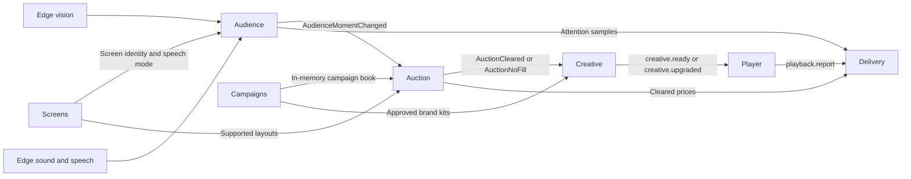

# Bounded context map

| Context | Owns | Interface |
|---|---|---|
| [Screens](app/modules/screens/CONTEXT.md) | Screen identity, presence, supported layouts and speech mode | Screen lookup and configuration |
| [Audience](app/modules/audience/CONTEXT.md) | Classification, signal fusion and debounced moments | `AudienceMomentChanged` carries an immutable `AudienceMomentSnapshot` |
| [Campaigns](app/modules/campaigns/CONTEXT.md) | Brands, approved assets, bids, campaign eligibility facts and budgets | In-memory campaign book and brand-kit queries |
| [Auction](app/modules/auction/CONTEXT.md) | Bundle compatibility, winner selection and clearing prices | Ad opportunity in, `AuctionCleared` or `AuctionNoFill` out |
| [Creative](app/modules/creative/CONTEXT.md) | Creative spec composition and media upgrades | `creative.ready` and `creative.upgraded` |
| [Delivery](app/modules/delivery/CONTEXT.md) | Proof of play, measured attention and the charges ledger | `playback.report` in, `ChargeRecorded` out |

Edges describe the full design. The local simulator connects the agent socket
to Audience, Auction and Creative through in-process calls. The WebSocket
contract is shared with the existing player.

Recognition runs in the perception agent. Classification lives in Audience
because the segment catalog, speech expiry and moment debounce determine
when Auction sees a change. The auction receives aggregate segment
estimates and safety facts through the published snapshot.

## Latency paths

- **Hot** uses the latest screen snapshot, deterministic tagging, in-memory bids
  and a cached or template creative. The player keeps a house ad or the last
  good creative available.
- **Warm** refines the current moment with tags from face-blurred keyframes and
  opt-in speech topics. Creative upgrades use validated copy, voice-over and
  budgeted video. Apply a result only while its target moment or creative is
  current.
- **Cold** prepares approved brand assets, bundle loops and cached voice-overs
  for immediate use during playback.

## First integration slice

The [audience replay runbook](docs/simulator.md) exercises the implemented
slice from a simulator snapshot through fixture classification, a seeded
auction and template playback. Live recognition and warm upgrades can
extend the same interfaces.

The [runtime architecture](docs/architecture.md) specifies auction rules, message
contracts, latency budgets and the hot, warm and cold paths. The
[domain glossary](CONTEXT.md) defines the terms used across contexts.
