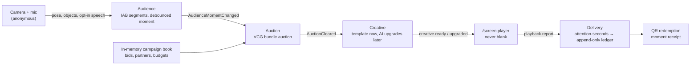

# ADverse: agentic ads for the physical world


**A store screen that sees the group in front of it, auctions the moment
among brands whose products go together, and shows a joint basket offer
sized to that group in about 1.5 seconds. Brands pay only for the seconds
people actually looked, and a QR redemption proves the sale.**

> *Pantallas que perciben a su audiencia de forma anónima y muestran ofertas
> conjuntas de marcas complementarias en tiempo real.*

Platanus Hack 26 (Santiago ft. Buk) · Track: 🌎 Physical World · team-18 ·
**Live deploy:** <https://team18-prod-web.onrender.com>

---

## Why

Online, one impression reaches one person. A physical screen is watched by
**N people at once**, each with a different need, yet it is sold to one
brand for one imagined viewer. Three friends in line at a gas station get a
car-insurance ad while a coffee machine sits two meters away.

ADverse sells **moments, not slots**:

| | Today's in-store screen | ADverse |
|---|---|---|
| Who wins the screen | One brand per slot | 1–2 *complementary* brands per moment (coffee + pastry) |
| Offer | Same loop for weeks | Basket sized to the group ("Trío $X"), evolving while they stay |
| Pricing | Traffic estimates | Per measured **attention-second**: zero attention costs zero |
| Proof | None | QR/promo redemption credited to every brand in the basket |

Full product thesis, metrics and scope: [`docs/product.md`](docs/product.md).

## How it works



**see → understand → auction → compose → play → measure → bill → prove**

Each stage runs on one of three latency paths
([ADR 0001](docs/adr/0001-three-speed-latency-paths.md)):

- **Hot** (every decision): YOLO26 pose and objects, moment change, the
  auction and a cached or template creative. No network model call is ever
  awaited here.
- **Warm** (seconds later, upgrades in place): Claude Haiku tags and copy,
  ElevenLabs voice-over, turbo video upgrade under a budget cap.
- **Cold** (prepared ahead): brand kits, a pre-generated video loop per
  compatible bundle, cached voice-overs.

Runtime topology, latency budget, auction algorithm and message contract:
[`docs/architecture.md`](docs/architecture.md).

## Measured, not claimed

| What | Result | Source |
|---|---|---|
| Server-side decision (audience → auction → creative) | p95 **4.27 ms** (target < 30 ms) | [`docs/latency-feedback-loop.md`](docs/latency-feedback-loop.md) |
| Camera scene to visible ad, simulated 80 ms detector | **1,112 ms** (target p50 < 1.5 s) | same |
| AI copy safety, 23 cases on recorded model responses | Guard rejects **41 / 41** adversarial outputs, **0** violations aired, AI copy on air **83 %** | `make eval-creative`, [`docs/creative-generation.md`](docs/creative-generation.md) |

Every decision carries a latency trace (`measured_at` → `received_at` →
`cleared_at` → `ready_at` → `displayed_at`) that the console shows live.

## Guarantees the code enforces

These six product invariants are covered by tests and never relaxed, even
for the demo ([`docs/product.md`](docs/product.md),
[`docs/privacy.md`](docs/privacy.md)):

1. **Pre-approved partners only, never competitors.** Baskets form only from
   pairs on both brands' allow-lists. Exclusion is a pure `Specification`,
   and every exclusion reason is shown in the console.
2. **Minors are protected, never targeted.** A likely minor only *blocks*
   age-restricted categories.
3. **No identity, nothing stored.** No frames, audio, transcripts, face
   recognition or forbidden inferences. Anything sent to a third-party model
   is face-blurred first. Speech mode is opt-in per screen.
4. **Logos are never AI-generated.** AI writes copy only, and a guard checks
   that the price matches digit for digit, that no competitor is named and
   that every claim is approved.
5. **The screen is never blank.** A house ad or the last good creative is
   always ready.
6. **Money is `Money`.** `Decimal` plus currency, never `float`. Charges go
   to an append-only ledger.

## Quickstart

Requirements: [`uv`](https://docs.astral.sh/uv/), Node 24, Docker (only if
you want Postgres), a webcam. The GPU is optional: the perception agent
falls back to a local detector.

```bash
make up            # one command: creates .env, installs deps, bakes models, runs the station
# open http://localhost:5188/screen   (the TV)
# open http://localhost:5188/console  (auction, coverage, latency; flip "En vivo")
```

### Run the demo

1. `make up` (or `make station` once set up). Add `ARGS="--paid-providers"`
   for live AI copy and voice.
2. On the TV (HDMI, Chromium fullscreen/kiosk), open the **screen**:
   <http://localhost:5188/screen?id=demo-01>
3. On the laptop facing the audience, open the **console** and flip "En vivo":
   <http://localhost:5188/console?screen=demo-01>
4. Optional, demo tools (bidding war, stock, campaigns, QA):
   `http://localhost:5188/demo/<DEMO_KEY>`, with `DEMO_KEY` from `.env`. Share
   `/demo/<DEMO_KEY>/advertiser` with judges; never put the key on a slide.

| Page | Local | Public (Render) |
|---|---|---|
| Screen (TV) | <http://localhost:5188/screen?id=demo-01> | <https://team18-prod-web.onrender.com/screen?id=demo-01> |
| Console | <http://localhost:5188/console?screen=demo-01> | <https://team18-prod-web.onrender.com/console?screen=demo-01> |

Both pages default to `demo-01`; change `id` / `screen` together to drive
another screen. Phones and a second laptop go through `:5188` (never `:8000`);
for QR codes over a tunnel, see [`docs/demo.md`](docs/demo.md).

Paid AI providers are off by default. Copy `.env.example` to `.env`, add
your `ANTHROPIC_API_KEY` and `ELEVENLABS_API_KEY`, and run
`make up ARGS="--paid-providers"`. No camera? `scripts/demo/rehearse.py`
replays scripted scenes ([`docs/simulator.md`](docs/simulator.md)).

| Command | What it does |
|---|---|
| `make check` | Same gates as CI: ruff, format, mypy, unit tests, contract drift, Terraform tests |
| `make eval` | Product evals on a live backend: demo beats, invariants, KPIs, latency ([`docs/evals.md`](docs/evals.md)) |
| `make web-check` | Web typecheck, lint, prettier, vitest, knip |
| `make help` / `make help-all` | Every target |

## Repository map

| Path | What | Stack |
|---|---|---|
| [`app/`](app/) | Backend: six DDD bounded contexts plus a shared kernel | Python 3.14, FastAPI, Pydantic, psycopg2 |
| [`edge/`](edge/) | Perception agent: camera, pose, objects, tracking, speech | Python 3.12, YOLO26, ByteTrack, Silero VAD, ElevenLabs Scribe |
| [`gpu/`](gpu/) | Stateless remote YOLO inference service ([ADR 0007](docs/adr/0007-remote-gpu-perception.md)) | Docker, TensorRT, WSS |
| [`web/`](web/) | `/screen` player and `/console` | Vite, React, TypeScript |
| [`evals/`](evals/) | Scenario evals with gates and a baseline ratchet | Python (`python -m evals`) |
| [`tests/`](tests/) | Unit, architecture-guardrail, integration and sandbox tests | pytest, hypothesis |
| [`db/migrations/`](db/migrations/) | Plain SQL migrations | PostgreSQL |
| [`terraform/`](terraform/) | Render infrastructure as code, with `terraform test` | Terraform |
| [`docs/`](docs/) | Product, architecture, ADRs, demo, evals, privacy | [index](docs/README.md) |

Bounded contexts and how they talk: [`CONTEXT-MAP.md`](CONTEXT-MAP.md).
Domain vocabulary (moment, bundle, attention-second…): [`CONTEXT.md`](CONTEXT.md).

## Engineering quality

- **Architecture enforced in CI.** `tests/unit/architecture/` fails the
  build if the domain does IO, logs or mints ids, if application code
  imports an adapter, or if SQL mutates an append-only table.
- **Deterministic core.** The auction is a pure function of (moment,
  campaigns, layouts) with stable tie-breaking. Domain tests use a fake
  `Clock` and a deterministic `IdGenerator`.
- **One wire contract.** `app/contract/messages.py` is the source of truth.
  The TypeScript types are generated (`make contract`), and CI fails on drift.
- **Evals as a feedback loop.** Demo beats, invariants and latency run
  against a live backend in CI. A bug found in rehearsal becomes a scenario
  first, and known gaps are strict `xfail` tests.
- **Decisions are written down.** Ten ADRs in [`docs/adr/`](docs/adr/).

## Documentation

Start at the [documentation index](docs/README.md). The essentials:
[product](docs/product.md) · [architecture](docs/architecture.md) ·
[stack](docs/stack.md) · [demo script](docs/demo.md) · [evals](docs/evals.md) ·
[privacy evidence](docs/privacy.md) · [ADRs](docs/adr/README.md).
Contributors and coding agents: [`CLAUDE.md`](CLAUDE.md) (also `AGENTS.md`).

## Team

- Augusto Tagle Montes ([@atagle123](https://github.com/atagle123))
- Benjamin Rodriguez ([@benrodriguez798](https://github.com/benrodriguez798))
- Matias Billwiller ([@Billwillerm](https://github.com/Billwillerm))
